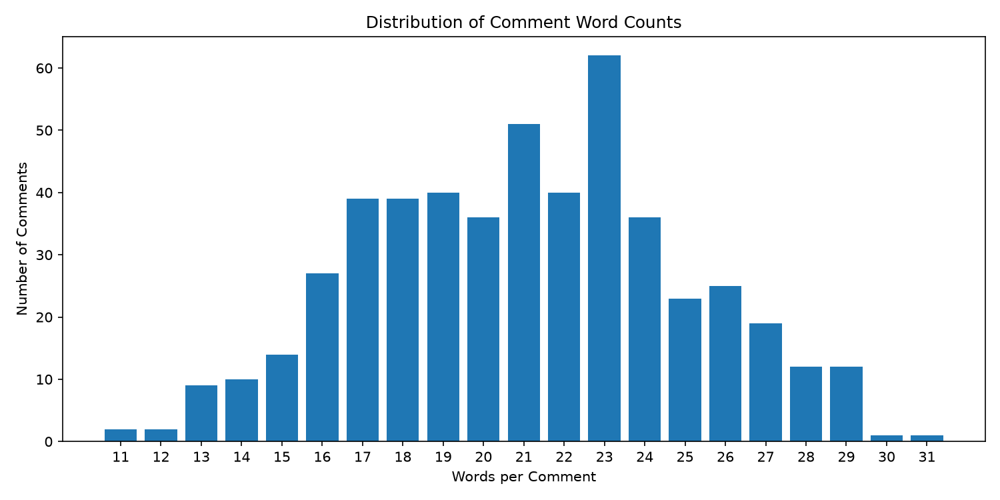
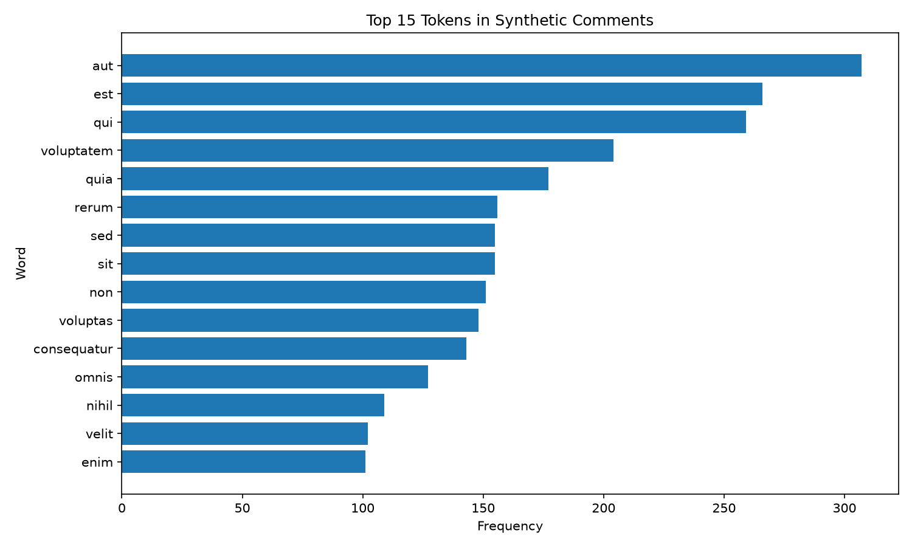

# nlp-04-api-text-data-custom

[](pyproject.toml)
[](https://github.com/BethSpornitz/nlp-04-api-text-data-custom/actions/workflows/ci-python-zensical.yml)
[](https://BethSpornitz.github.io/nlp-04-api-text-data-custom/)

[](https://docs.astral.sh/uv/)
[](https://docs.astral.sh/ty/)
[](https://zensical.org/)
[](LICENSE)


> Retrieve and validate JSON comments from an API, transform the data into an analysis-ready dataset, and explore comment lengths and token frequencies using Python.


## Project Overview

Author: Beth Spornitz

Date: 2026 November

Fourth project in the Web Mining and Applied NLP course.

This project demonstrates how to retrieve, validate, and transform
JSON data from a web API into an analysis ready dataset.

The custom application uses comments from JSONPlaceholder to
explore frequently occurring words in comment text.

The project follows an Extract, Validate, Transform, Load (EVTL)
pipeline and is configured in [pyproject.toml](pyproject.toml).

## Data

The custom application uses the
[JSONPlaceholder Comments API](https://jsonplaceholder.typicode.com/comments),
a public API containing simulated comment records.

Each record includes:

- Post identifier.
- Comment identifier.
- Name.
- Email address.
- Comment body text.

The pipeline is designed to preserve the raw JSON response
and produce a structured CSV dataset.

## Approach

The project uses four EVTL stages:

- **Extract:** Retrieve JSON comments from the API.
- **Validate:** Check the structure, required fields, and data types.
- **Transform:** Select useful fields and calculate text features.
- **Load:** Save the processed records to a CSV file.


The custom transformation calculates two derived text features: character length and space-delimited word count for each comment body.

An additional analysis tokenizes the comment text, converts words to lowercase, removes punctuation, filters selected stopwords, and identifies the 15 most frequent remaining tokens.

Requests retrieves the API data, Polars processes the structured records, and Matplotlib creates the visualizations.


Important project components:

- [pyproject.toml](pyproject.toml) - Project configuration and dependencies.
- [src/nlp/](src/nlp/) - Original and custom Python pipeline files.
- [tests/](tests/) - Automated tests.
- [docs/](docs/) - Project documentation.
- [zensical.toml](zensical.toml) - Documentation configuration.


## Run the Project

Follow the [Professional Python Workflow Guide](https://denisecase.github.io/pro-analytics-02/) to set up the development environment.

From a VS Code terminal in the project root, synchronize the environment:

```powershell
uv sync
```

Run the original example pipeline:

```powershell
uv run python -m nlp.pipeline_api_json
```

Run the custom JSONPlaceholder comments pipeline:

```powershell
uv run python -m nlp.pipeline_api_json_beth
```

Generate the comment-length and token-frequency visualizations:

```powershell
uv run python -m nlp.visualize_comments_beth
```

The custom pipeline saves its raw and processed data separately from the original example.


## Results

The custom EVTL pipeline successfully retrieves, validates, transforms, and saves 500 JSONPlaceholder comment records.

The processed dataset contains seven columns:

- `post_id`
- `comment_id`
- `name`
- `email`
- `body`
- `body_length`
- `body_word_count`

### Comment Length Analysis

The comments contain an average of 21.03 space-delimited words.

- Minimum: 11 words
- Maximum: 31 words
- Records analyzed: 500



### Token Frequency Analysis

An additional text analysis identifies the 15 most frequent tokens after lowercasing, punctuation removal, and filtering selected stopwords.

The three most frequent remaining tokens are:

- `aut`: 307 occurrences
- `est`: 266 occurrences
- `qui`: 259 occurrences



The raw and processed datasets are available in:

- [Raw comments JSON](data/raw/beth_comments_raw.json)
- [Processed comments CSV](data/processed/beth_comments_processed.csv)


### Interpretation and Limitations

JSONPlaceholder provides synthetic comments containing Latin-like placeholder text. The records are useful for demonstrating API retrieval, JSON validation, data transformation, and text feature extraction, but they do not represent authentic conversations.

The comment-length analysis describes the structure of the sample text. The token-frequency analysis demonstrates preprocessing and counting techniques, but its results should not be interpreted as meaningful English-language topics or real user behavior.

The word-count feature uses space-delimited tokens rather than full linguistic tokenization. The frequency analysis uses a limited stopword list and does not perform lemmatization or contextual language analysis.

The raw and processed datasets are available in:

- `data/raw/beth_comments_raw.json`
- `data/processed/beth_comments_processed.csv`


## Verification

Run the automated tests:

```shell
uv run python -m pytest
```


## Project Documentation

The [hosted documentation site](https://BethSpornitz.github.io/nlp-04-api-text-data-custom/) uses Zensical and GitHub Pages.

The documentation describes the API source, JSON structure, validation requirements, transformation methods, derived text features, visualizations, results, interpretation, and limitations.


## CI/CD and GitHub Actions

This project includes continuous integration and continuous deployment (CI/CD)
to check project files and publish the docs.

GitHub Actions include:

- [CI: Python and Documentation Checks](https://github.com/BethSpornitz/nlp-04-api-text-data-custom/actions/workflows/ci-python-zensical.yml)
- [CD: Documentation Deployment](https://github.com/BethSpornitz/nlp-04-api-text-data-custom/actions/workflows/deploy-zensical.yml)

## Developer Reference

Follow the
[Professional Python Workflow Guide](https://denisecase.github.io/pro-analytics-02/)
for **detailed instructions and troubleshooting**.

### Initialize and Update the Python Environment

With the project open in VS Code, open a VS Code terminal.
Paste each command and hit Enter or Return after to run it.

```shell
uvx pup-clean --delete
uv self update
uv python pin 3.14
uv python install
uv lock --upgrade
uv sync
uv audit
```

### Set Up and Run Git Hooks

Set up and run the git hooks to perform
basic checks automatically before
any changes get pushed to GitHub.

In the VS Code terminal,
paste each command and hit Enter or Return after to run it.

```shell
uvx prek install --force
uvx prek update --freeze --cooldown-days 7

git add -A
uvx prek run --all-files
# repeat if changes were made
uvx prek run --all-files
```

### Run Common Chores

Run linters, formatters, type checks, tests, and
build the documentation.

```shell
uv run ruff check . --fix
uv run ruff format .

uv run ty check
uv run python -m pytest
uv run python -m zensical build
```

### Git add-commit-push to GitHub

After making useful changes, save your work to GitHub.

```shell
git add -A
git commit -m "describe your changes in quotes"
git push -u origin main
```

## Developer Notes

- Use the **UP ARROW** and **DOWN ARROW** in the terminal to scroll through past commands.
- Use `CTRL+f` to find (and replace) text within a file.

## Developer Tools

This project uses professional Python tools to support development,
testing, documentation, and code quality.

- [uv](https://docs.astral.sh/uv/) - Python environments and dependencies.
- [Ruff](https://docs.astral.sh/ruff/) - Python linting and formatting, configured in [.ruff.toml](.ruff.toml).
- [ty](https://docs.astral.sh/ty/) - Python type checking.
- [pytest](https://docs.pytest.org/) - automated Python testing, configured in [.pytest.toml](.pytest.toml).
- [prek](https://prek.j178.dev/) - Git hooks and automated checks, configured in [prek.toml](prek.toml).
- [Zensical](https://zensical.org/) - project documentation, configured in [zensical.toml](zensical.toml).

## Links

- [GitHub Repository](https://github.com/BethSpornitz/nlp-04-api-text-data-custom)
- [Hosted Documentation](https://BethSpornitz.github.io/nlp-04-api-text-data-custom/)
- [Professional Python Workflow Guide](https://denisecase.github.io/pro-analytics-02/)
- [Citation](CITATION.cff)
- [License](LICENSE)
