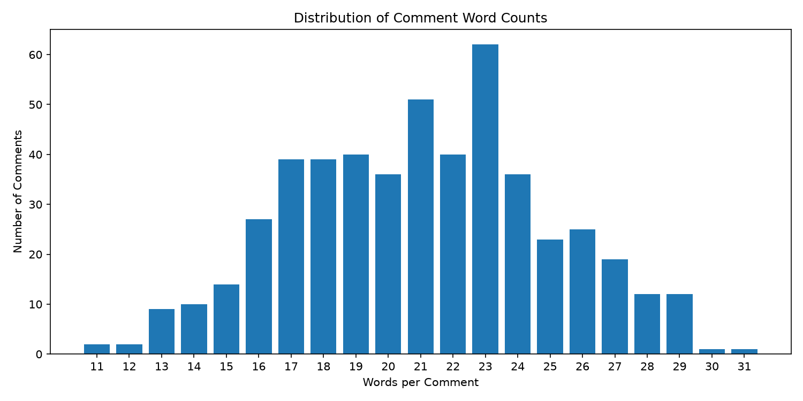
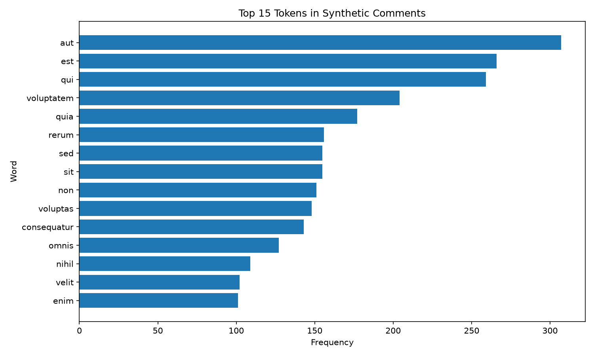

# Web Mining and Applied NLP Project Report

Web Mining and Applied NLP | Project 04 | Custom Application Report

**Author:** Beth Spornitz
**Date:** November 2026

## Overview

This project demonstrates structured text data acquisition using web APIs.

The objective is to retrieve JSON data, validate its structure, transform records into a tabular representation, and persist the results for analysis.

The project implements a modular Extract, Validate, Transform, Load (EVTL) pipeline with explicit inputs and outputs.

The original example retrieves posts from the JSONPlaceholder API. The custom application adapts the pipeline to retrieve comments from the JSONPlaceholder Comments API.

The custom application examines two questions:

- How long are the comments, as measured by word count?
- Which tokens occur most frequently in the comment text?

The project demonstrates how a reusable pipeline accommodates a different JSON structure while supporting basic text analysis.

## Tools and Methods

The project uses:

- Python for pipeline orchestration and processing.
- Requests for retrieving JSON data from a web API.
- JSON for representing structured source records.
- Validation checks for confirming expected data structures and field types.
- Polars for tabular transformation and derived text features.
- CSV for persistent output.
- Matplotlib for visualizing analytical results.
- Regular expressions and Python's Counter for token-frequency analysis.
- Logging for execution records.
- Ruff, ty, and pytest for code verification.
- Zensical and GitHub Pages for published documentation.

The original example retrieves post records from the JSONPlaceholder demonstration API.

The custom application retrieves 500 comment records from the [JSONPlaceholder Comments API](https://jsonplaceholder.typicode.com/comments).

The original posts contain `userId`, `id`, `title`, and `body`. The comments contain `postId`, `id`, `name`, `email`, and `body`.

The custom pipeline implements four stages:

- **Extract** - retrieve JSON comment records and preserve the raw response.
- **Validate** - verify the list structure, required fields, and expected data types.
- **Transform** - select five source fields and calculate character length and space-delimited word count.
- **Load** - save the transformed records to a CSV file.

Each stage is implemented as a separate Python module with explicit inputs and outputs.

The transformed dataset contains seven columns: `post_id`, `comment_id`, `name`, `email`, `body`, `body_length`, and `body_word_count`.

An additional analysis extracts lowercase alphabetic tokens, excludes short tokens, filters selected English stopwords, and counts the most frequent remaining tokens.

## Verification

A successful custom pipeline execution displays:

```text
Custom comments pipeline executed successfully!
```

The pipeline records execution details in a project log.

The following custom artifacts are created:

- `data/raw/beth_comments_raw.json` - original comments API response.
- `data/processed/beth_comments_processed.csv` - transformed comments dataset.
- `docs/images/comment_word_counts.png` - comment word-count distribution.
- `docs/images/comment_top_words.png` - token-frequency visualization.

The original example also produces its own raw JSON and processed CSV artifacts.

### Comment Word Count Results

The custom pipeline processes 500 records and produces seven columns.

| Measure | Result |
|---|---:|
| Records | 500 |
| Average word count | 21.03 |
| Minimum word count | 11 |
| Maximum word count | 31 |



### Token Frequency Results

The additional analysis identifies the 15 most frequent remaining alphabetic tokens.



The three most frequent tokens are:

| Token | Frequency |
|---|---:|
| `aut` | 307 |
| `est` | 266 |
| `qui` | 259 |

These results demonstrate that the pipeline can acquire, validate, transform, persist, and analyze structured text data.

Automated tests provide additional verification of the pipeline's expected behavior.

## Interpretation

The code successfully retrieved and processed 500 comments from the JSONPlaceholder API.  The comments averaged 21 words with lengths ranging from 11-31 words.

The word frequency correctly identified the most common words, but since the text is simulated Latin text rather than conversations the frequent words don't tell us much.

The project successfully showed how to adapt an existing pipeline to a different API, validate the data and calculate text features.  It also enforces that you must understand the source data before decided that you can draw any conclusions from it.

## Documentation Index

- **Home** - this landing page
- [**Project Instructions**](project-instructions.md)
- [**Glossary**](glossary.md)

## Project Links

- [GitHub Repository](https://github.com/BethSpornitz/nlp-04-api-text-data-custom)
- [Original Example Pipeline](https://github.com/BethSpornitz/nlp-04-api-text-data-custom/blob/main/src/nlp/pipeline_api_json.py)
- [Custom Comments Pipeline](https://github.com/BethSpornitz/nlp-04-api-text-data-custom/blob/main/src/nlp/pipeline_api_json_beth.py)
- [Custom Configuration](https://github.com/BethSpornitz/nlp-04-api-text-data-custom/blob/main/src/nlp/config_beth.py)
- [Custom Validation](https://github.com/BethSpornitz/nlp-04-api-text-data-custom/blob/main/src/nlp/stage02_validate_beth.py)
- [Custom Transformation](https://github.com/BethSpornitz/nlp-04-api-text-data-custom/blob/main/src/nlp/stage03_transform_beth.py)
- [Custom Visualization Code](https://github.com/BethSpornitz/nlp-04-api-text-data-custom/blob/main/src/nlp/visualize_comments_beth.py)
- [Processed Comments CSV](https://github.com/BethSpornitz/nlp-04-api-text-data-custom/blob/main/data/processed/beth_comments_processed.csv)

## Project Resources

- [Project Instructions](project-instructions.md)
- [Professional Python Guide](https://denisecase.github.io/pro-analytics-02/)
- [Professional Python Project Explainer](https://pup-pack.github.io/professional-python-project-explainer/)
